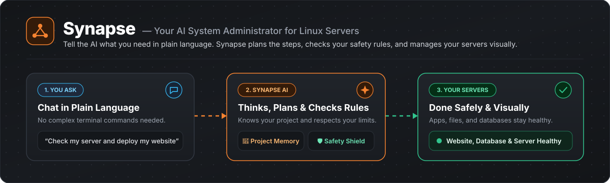
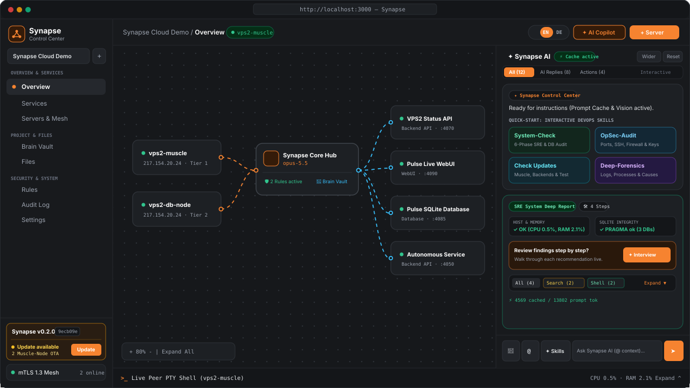
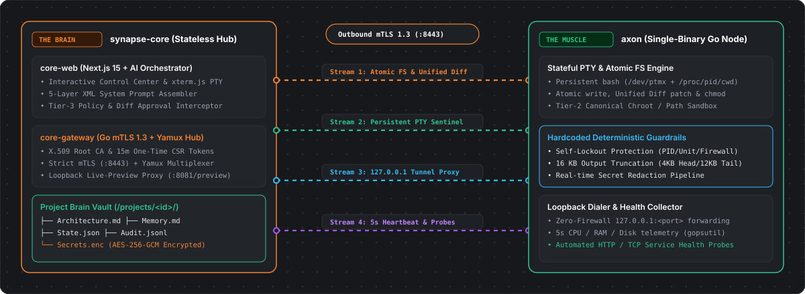
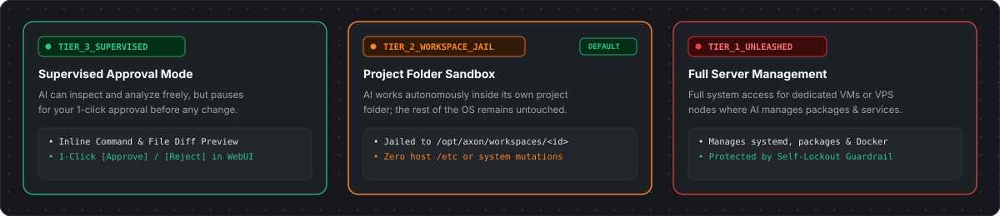

<div align="center">



<br />

[](./README.md)
[-f68330?style=for-the-badge&labelColor=181a1d)](./README.de.md)

[](https://github.com/SolidStateNetwork/Synapse/actions/workflows/ci.yml)
[](https://github.com/SolidStateNetwork/Synapse/releases)
[](#)
[](#)
[-f68330?labelColor=181a1d)](./LICENSE)

### **Synapse — Dein KI-verwaltetes Server- & DevOps-Control-Center**
Verwalte, überwache und repariere deine Linux-Server gemeinsam mit einer KI – über eine aufgeräumte grafische Oberfläche und einen integrierten **Model Context Protocol (`MCP`) Server** statt stundenlanger Fehlersuche im Terminal.

[Was ist Synapse?](#-was-ist-synapse) · [Die 6 Kernpfeiler](#-die-6-kernpfeiler) · [Wie ist Synapse aufgebaut?](#-wie-ist-synapse-aufgebaut-core--muscle) · [Sicherheit & Kontrolle](#️-sicherheit--kontrolle) · [Schnellstart](#-schnellstart-in-2-schritten) · [Architektur-Lexikon](#-repository-navigation--architektur-lexikon)

</div>

---

## 💡 Was ist Synapse?

Wer einen oder mehrere Linux-Server betreibt, kennt den Alltag: Man verbindet sich per SSH, sucht in langen Log-Dateien nach Fehlern, passt Konfigurationsdateien von Hand an, spielt Updates ein und prüft danach mühsam, ob noch alle Dienste laufen.

**Synapse ist ein KI-gesteuertes Infrastruktur-Control-Center (`v2.1.0`), das dir diese Arbeit abnimmt.**

Statt selbst Befehle im Terminal einzutippen, arbeitest du in einer visuellen Oberfläche (jederzeit per Klick zwischen **Deutsch** und **Englisch** umschaltbar) mit einem integrierten KI-Systemadministrator zusammen – oder verbindest externe KI-Clients wie **Claude Desktop, Cursor oder Windsurf** direkt über den eingebauten **MCP-Server (`/api/mcp`)**. Die KI ist über einen ausgehenden `mTLS 1.3`-Tunnel mit deinen Servern verbunden: Sie prüft den Systemzustand, richtet Dienste ein, legt vor Änderungen automatisch **Pre-Flight Time-Machine Checkpoints** an und heilt ausgefallene Dienste selbstständig – während du jederzeit die volle Übersicht und das letzte Wort behältst.

---

## 🎯 Die 6 Kernpfeiler

### 1. Interaktiver KI-Chat, fertige Prüf-Skills & Interview-Modus
Neben dem normalen Chat (in dem du der KI in Alltagssprache Aufgaben geben, Server per `@` erwähnen oder Screenshots hineinziehen kannst) bringt Synapse fertige **DevOps-Skills** mit, die du direkt im KI-Panel oder über **`✨ Skills`** startest:
- **`CheckSystem`:** Prüft deine Server gründlich auf Herz und Nieren (Auslastung, laufende Dienste, SQLite-Datenbanken, Logs und Konfiguration).
- **`CheckOpsec`:** Untersucht das System auf Sicherheitsrisiken (offene Ports, SSH-Einstellungen, Firewall, Dateirechte und HTTP-Header).
- **`CheckUpdates`:** Prüft alle verbundenen Server, Dienste und Systempakete auf verfügbare Updates, fragt dich im Bericht um Freigabe und führt danach automatisch einen Funktionstest durch.
- **`DeepForensics` & `SkillSearch`:** Findet versteckte Fehlerursachen in Logs oder zeigt dir sofort, wo sich eine bestimmte Datei, Einstellung oder Funktion im System befindet.

> **Der Interview-Modus:** Wenn ein Skill seinen Bericht fertiggestellt hat, ändert die KI nichts ungefragt. Mit einem Klick auf **„Interview starten"** geht die KI jeden gefundenen Punkt einzeln mit dir durch und fragt dich: *„Jetzt beheben oder überspringen?"*

### 2. Visuelle Topologie-Übersicht, Service-Workbench & direkter App-Tester im Browser
Auf der Startseite (**Übersicht**) siehst du alle verbundenen Server, die KI-Zentrale und deine laufenden Anwendungen als interaktive Karten, die du mit der Maus aufklappen und frei anordnen kannst:

<div align="center">
  
</div>

- **Sofort testen ohne Firewall-Stress:** Wenn die KI auf deinem Server eine Web-App, eine API oder eine Datenbank startet, kannst du sie unter **Services** (`GET`/`POST`/`PUT`/`DELETE`/`SQL` Workbench) direkt im Browser öffnen und testen – ganz ohne Ports in deiner Server-Firewall nach außen öffnen zu müssen.
- **GitOps Stack-Deployer, Live-Log Inspector & Cron-Due Runner:** Git-Repositories per 1-Klick klonen und starten (`docker compose up -d --build`) inklusive automatischer `Secrets.enc` -> `0600 .env`-Injektion, Webhook-Redeploy & Teardown, Live-Logs (`docker`/`systemd`/`workspace`) direkt über den mTLS-Tunnel inspizieren sowie zeitgesteuerte Cron-Runbooks ausführen.
- **Live-Code Hot-Reload & SQLite Data Studio:** Laufenden Microservice-Code direkt im Browser mit automatischer Python-Syntaxprüfung und Rollback-Schutz aktualisieren oder SQLite-Datenbanken live abfragen.

### 3. Automatische Pre-Flight Time-Machine Checkpoints & Autonome Selbstheilung
- **Pre-Flight Time-Machine Checkpoints (`chk-...`):** Vor jeder zustandsverändernden Aktion (Blueprint-Deploy/Undeploy, GitOps-Rollout/Teardown, Custom-Service-Deploy, Code-Hot-Reload, Firewall-Änderung oder System-Update) legt Synapse automatisch einen wiederherstellbaren **Time-Machine Checkpoint** an und zeigt die `checkpoint_id` direkt als Badge in der Oberfläche an.
- **Autonomous Self-Healing & Chaos-Resilience:** Überwacht laufende Dienste kontinuierlich, startet ausgefallene Container oder Prozesse automatisch neu, misst die **MTTR (Mean Time To Recovery)** und unterstützt 1-Klick Chaos-Simulationen.
- **Verschlüsselte Offsite-Backups (`AES-256-GCM`):** Komplette Projekt- und Workspace-Sicherungen im Core-Vault speichern und wiederherstellen.

### 4. Integrierter Model Context Protocol (`MCP`) Server (`/api/mcp` — 33 Tools)
Verbinde **Claude Desktop, Cursor, Windsurf oder jeden anderen MCP-fähigen KI-Client** direkt per Streamable HTTP JSON-RPC 2.0 (`/api/mcp`) mit deiner Synapse-Steuerzentrale:
- **33 Full-Stack-Tools:** 100 % Funktionsparität über PTY-Befehle, Dateisystem, GitOps-Stacks, Time-Machine Checkpoints, Offsite-Backups, Self-Healing, Service-Mesh-Probes, 1-Click Blueprints, Domain/TLS-Bindings, Synapse Shield Firewall, AI Rule Cartridges, Cluster-Enrollment, geplante KI-Playbooks, Freigaben (`Approvals`), Service-Workbench und Plattform-Selbsttests.
- **Gehashte SHA-256 API-Keys (`syn_mcp_...`):** Vergib feingranulare `read`-, `execute`- oder `admin`-Berechtigungen und widerrufe Schlüssel jederzeit per 1-Klick.

### 5. Versionsanzeige & 1-Klick OTA-Updates (Bare-Metal & Container-Native)
Unten links in der Seitenleiste siehst du jederzeit die aktuell installierte Version (`v2.1.0`) und den Commit-Stand:
- **1-Klick Rollout mit Pre-Flight Checkpoint:** Sobald für **Core** oder deine verbundenen **Muscle**-Server ein Update bereitsteht, legt der **`Update`**-Button automatisch einen Pre-Flight Time-Machine Checkpoint an und aktualisiert sowohl klassische Systemd-Dienste als auch Container-Umgebungen.

### 6. Projekt-Gedächtnis (`Brain Vault`) & Modulare KI-Regeln (`Regeln`)
- **Persistenter Brain Vault:** Pflegt für jedes Projekt automatisch `Architecture.md` (inkl. interaktivem Topologie-Graphen) und `Memory.md` (technisches Logbuch).
- **1-Klick Rule Cartridges:** Aktiviere fertige oder eigene Architektur-Vorgaben (*Docker-First*, *Zero-Trust Networking*, *Native Systemd*), an die sich die KI bei jeder Aufgabe automatisch hält.

---

## 🧠 Wie ist Synapse aufgebaut? (Core & Muscle)

Synapse besteht aus zwei klar getrennten Teilen:

1. **Der Core („Das Gehirn" — `synapse-core`):**
   Deine zentrale Weboberfläche inklusive KI-Steuerung und verschlüsseltem Passwort-Tresor. Auf dem Core selbst wird niemals fremder Programmcode ausgeführt.
2. **Der Muscle („Die Hände" — `axon`):**
   Ein kleines, schlankes Programm (eine einzige Datei ohne Abhängigkeiten), das du auf deinen Linux-Servern installierst. Es verbindet sich verschlüsselt mit deinem Core und führt dort genau die Befehle und Datei-Änderungen aus, die für deine Projekte nötig sind.

<div align="center">
  
</div>

---

## 🛡️ Sicherheit & Kontrolle

Du entscheidest für jeden Server selbst, wie viel Spielraum die KI bekommt:

<div align="center">
  
</div>

1. 🟢 **Überwachter Modus (`TIER_3_SUPERVISED`):** Die KI darf lesen und analysieren, fragt dich aber vor jeder Datei-Änderung und vor jedem Befehl in der Oberfläche um Erlaubnis.
2. 🟡 **Projekt-Ordner (`TIER_2_WORKSPACE_JAIL` — Standard):** Die KI darf innerhalb ihres eigenen Projekt-Ordners (`/opt/axon/workspaces/...`) selbstständig arbeiten, hat aber keinen Zugriff auf das restliche Betriebssystem.
3. 🔴 **Vollzugriff (`TIER_1_UNLEASHED`):** Für eigene VMs oder Server, auf denen die KI auch Systempakete installieren, Dienste neu starten und die gesamte Maschine verwalten soll.

Zusätzlich schützt sich Synapse selbst:
- **Passwörter bleiben geheim:** Zugangsdaten werden verschlüsselt gespeichert (`AES-256-GCM`) und niemals im Klartext im Chat oder in Logs angezeigt.
- **1-Klick Rückgängig (Rollback):** Vor jeder Datei-Änderung legt Synapse automatisch eine Sicherungskopie an, sodass du Änderungen im Chat mit einem Klick rückgängig machen kannst.
- **Vollständiges Protokoll (`Audit-Log`):** Jede Aktion der KI wird nachvollziehbar im Audit-Log protokolliert.

---

## 🚀 Schnellstart in 2 Schritten

### Schritt 1 — Steuerzentrale (`Core`) mit Docker starten
Führe diesen Befehl auf dem System aus, auf dem deine Weboberfläche laufen soll:

```bash
curl -fsSL https://raw.githubusercontent.com/SolidStateNetwork/Synapse/main/scripts/deploy-core.sh | bash
```

Danach erreichst du das **Synapse Control Center** im Browser unter `http://<DEINE_CORE_IP>:3000`.

### Schritt 2 — Linux-Server (`Muscle`) verbinden
Klicke oben rechts in der Weboberfläche auf **`+ Server`**, erzeuge über **„Setup-Schlüssel erzeugen"** einen Einmal-Schlüssel und führe den angezeigten Befehl auf deinem Linux-Server aus:

```bash
curl -fsSL http://<DEINE_CORE_IP>:8081/install.sh | sudo sh -s -- <EINMAL_TOKEN> TIER_2_WORKSPACE_JAIL
```

Der Server verbindet sich automatisch im Hintergrund (ohne dass du eingehende Ports in deiner Firewall öffnen musst) und erscheint sofort live auf deiner Übersichtskarte.

---

## 🛠️ Lokales 2-Container-Labor & Entwickler-Build

```bash
# Option A: Komplettes lokales 2-Container-Labor starten (synapse-core + synapse-muscle)
bash containers/manage.sh restart
bash containers/manage.sh status

# Option B: Vollständige Test- & Coverage-Gates ausführen (>= 85% Go über 11 Pakete, >= 90% TS Line-Coverage)
go test -v -race -cover ./proto/... ./agents/axon/... ./apps/core-gateway/...
npm --prefix apps/core-web ci
npx --prefix apps/core-web tsc -p apps/core-web/tsconfig.json --noEmit
npm --prefix apps/core-web test -- --experimental-test-coverage
npm --prefix apps/core-web run build
```

---

## 📂 Repository-Navigation & Architektur-Lexikon

- **Architektur- & Engineering-Spezifikationen:** [`architecture/`](./architecture/)
  - [`00-product-vision.md`](./architecture/00-product-vision.md) – Core („The Brain“) & Muscle („The Hands“) Trennung & die 3 Autonomie-Stufen
  - [`01-tech-stack-and-monorepo.md`](./architecture/01-tech-stack-and-monorepo.md) – Go 1.23 Workspace, Next.js 15 Studio & `< 500` Go / `< 600` TS Modularisierungs-Gates
  - [`02-mtls-tunnel-and-axon-agent.md`](./architecture/02-mtls-tunnel-and-axon-agent.md) – ECDSA P-256 PKI, Yamux-Multiplexing, Ephemeral PTY GC & Self-Lockout Guard
  - [`03-ai-orchestrator-and-mcp-server.md`](./architecture/03-ai-orchestrator-and-mcp-server.md) – 33 AI/MCP-Tools, Prompt-Caching & Streamable HTTP JSON-RPC 2.0 MCP-Server
  - [`04-resilience-security-and-ota.md`](./architecture/04-resilience-security-and-ota.md) – `AES-256-GCM` Secret Vault, Pre-Flight Time-Machine Checkpoints, Self-Healing & OTA
- **Projekt-Gedächtnis & Roadmap:** [`memory/`](./memory/)
  - [`PROJECT_STATE.md`](./memory/PROJECT_STATE.md) – Echtzeit-Statusmatrix aller Subsysteme (`v2.1.0`)
  - [`MILESTONES.md`](./memory/MILESTONES.md) – End-to-End Entwicklungs-Fahrplan (`Phase 1`–`Phase 6`)
  - [`BLACKBOX.md`](./memory/BLACKBOX.md) – Chronologisches Entwicklungs-Logbuch & Architecture Decision Records (`ADR-001`–`ADR-006`)
- **Standard-Playbooks (SOPs):** [`playbooks/`](./playbooks/)
  - [`01-feature-and-milestone-sop.md`](./playbooks/01-feature-and-milestone-sop.md) – SOP für Feature-Entwicklung, Modularisierung & Coverage-Gates
  - [`02-container-lab-and-release-sop.md`](./playbooks/02-container-lab-and-release-sop.md) – SOP für das lokale 2-Container-Labor & GitHub-Releases
- **Governance, Sicherheit & Changelog:** [`AGENTS.md`](./AGENTS.md) · [`CONTRIBUTING.md`](./CONTRIBUTING.md) · [`SECURITY.md`](./SECURITY.md) · [`CHANGELOG.md`](./CHANGELOG.md)

---

## 📄 Lizenz

Veröffentlicht unter der [Synapse Source-Available Non-Commercial License](./LICENSE) (`Copyright (c) 2026 SolidStateNetwork — Alle Rechte vorbehalten`). Kostenlos für private Nutzung, Tests und nicht-kommerzielles Self-Hosting; kommerzieller Verkauf, Weiterverkauf oder das Anbieten als Managed-Cloud-/SaaS-Dienst ist ohne schriftliche Lizenz von SolidStateNetwork streng untersagt. Hinweise zur Sicherheit findest du in [SECURITY.md](./SECURITY.md).
