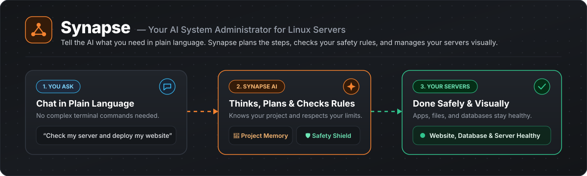
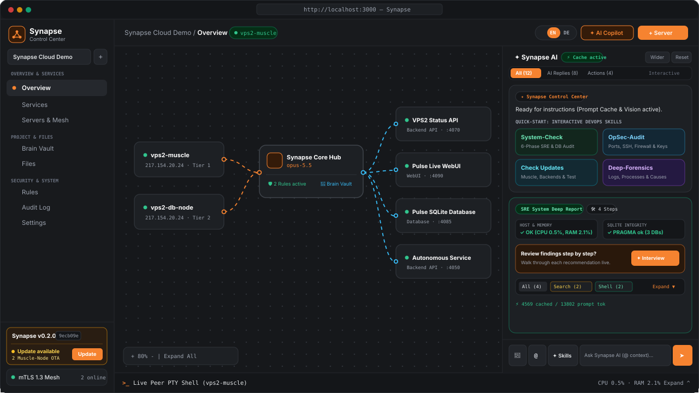
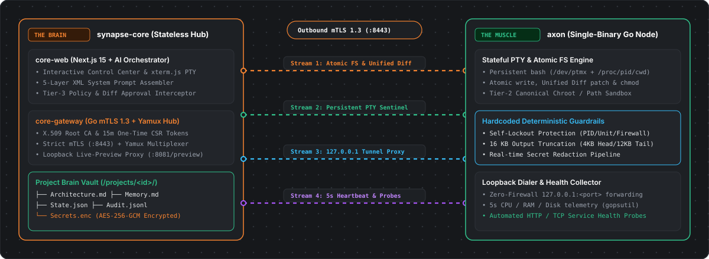
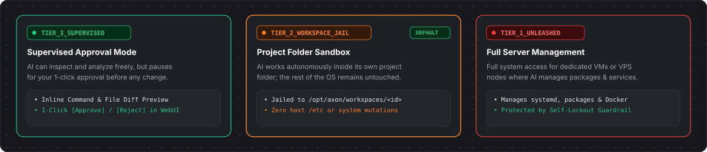

<div align="center">



<br />

[-f68330?style=for-the-badge&labelColor=181a1d)](./README.md)
[](./README.de.md)

[](https://github.com/SolidStateNetwork/Synapse/actions/workflows/ci.yml)
[](https://github.com/SolidStateNetwork/Synapse/releases)
[-f68330?labelColor=181a1d)](./LICENSE)

### **Synapse — Your AI-Managed Linux Server & DevOps Control Center**
Manage, monitor, and repair your Linux servers together with an AI — through a clean visual control center instead of hours of manual troubleshooting in the terminal.

[What is Synapse?](#-what-is-synapse) · [The 5 Core Features](#-the-5-core-features) · [How It Works (Core & Muscle)](#-how-is-synapse-built-core--muscle) · [Security & Control](#️-security--control) · [Quick Start](#-quick-start-in-2-steps)

</div>

---

## 💡 What is Synapse?

Anyone running one or more Linux servers knows the routine: connecting via SSH, digging through endless log files for errors, editing configuration files by hand, applying updates, and manually checking whether every service is still healthy afterward.

**Synapse is an AI-Managed Infrastructure Tool designed to take that routine work off your shoulders.**

Instead of typing shell commands yourself, you work inside a visual dashboard (available in **English** and **German**) alongside an integrated AI system administrator. The AI is connected directly to your servers: it can inspect system health, deploy services, audit security, prepare updates, and fix issues — while you stay in full visual control and keep the final say on every change.

---

## 🎯 The 5 Core Features

### 1. Interactive AI Chat, 1-Click DevOps Skills & Interview Mode
Beyond normal chat (where you can give instructions in plain language, reference servers with `@`, or drag and drop screenshots), Synapse includes ready-to-use **DevOps Skills** right inside the AI Copilot panel:
- **`CheckSystem`:** Runs a deep health audit across your servers (CPU/RAM/disk, running services, SQLite databases, logs, and configuration).
- **`CheckOpsec`:** Audits your servers for security risks (open ports, SSH configuration, firewall rules, file permissions, and HTTP headers).
- **`CheckUpdates`:** Checks all connected servers, services, and system packages for available updates, asks for your approval, and automatically runs an end-to-end functional test afterward.
- **`DeepForensics` & `SkillSearch`:** Finds hidden root causes in logs or immediately locates any file, port, database table, or feature across your infrastructure.

> **Interactive Interview Mode:** After a skill finishes its report, the AI never modifies your system unprompted. Click **"Start Interview"** and the AI walks you through each finding one by one, asking: *"Fix this item now or skip?"*

### 2. Visual Topology Canvas & Built-In Browser App Tester
On the main **Overview** screen, all connected servers, the AI hub, and your running applications appear as interactive cards that you can expand and arrange freely:

<div align="center">
  
</div>

- **Test Services Without Opening Firewall Ports:** When the AI deploys a web app, an API, or a SQLite database on your server, you can open and test it directly inside your browser under **Services** — without exposing public ports on your server's firewall.
- **Built-In Live Terminal & File Explorer:** Whenever you want to inspect something yourself, expand the live Linux terminal at the bottom of the screen or edit files directly in the browser under **Files**.

### 3. Effortless 1-Click Updates (Bottom-Left Sidebar)
Just like NetBird, Synapse displays your current version and commit status right in the **bottom-left corner of the sidebar**:
- **Instant Update Notification & Rollout:** Whenever a new update is available for the control center (**Core**) or your connected Linux servers (**Muscle**), an **`Update available`** badge and a **`Update`** button appear right in the bottom-left sidebar for 1-click over-the-air updates.

### 4. Project Memory (`Brain Vault`) That Never Forgets
A standard AI chat forgets how your server is set up as soon as you start a new conversation. Synapse automatically maintains two living documents for every project under **Brain Vault**:
- **`Architecture.md`:** A clear documentation of your server topology, ports, and file paths (rendered with an interactive topology graph).
- **`Memory.md`:** An engineering journal where the AI records past fixes, configuration details, and lessons learned for your server.

### 5. Enforce Your Own Rules with 1 Click (`Rules`)
Under **Rules**, you can toggle ready-made policy guardrails (*Rule Cartridges*) to `ACTIVE` with a single click — such as *"Always use Docker containers"*, *"Never expose internal database ports to the public internet"*, or *"Manage services via hardened systemd units"*. The AI automatically follows your active rules on every task.

---

## 🧠 How is Synapse Built? (Core & Muscle)

Synapse is split into two clearly separated components:

1. **The Core ("The Brain" — `synapse-core`):**
   Your central web dashboard, AI orchestrator, and encrypted secret vault. Untrusted code or shell commands are never executed on the Core itself.
2. **The Muscle ("The Hands" — `axon`):**
   A lightweight, dependency-free single Go binary that you install on your Linux servers. It connects outbound to your Core over an encrypted `mTLS 1.3` tunnel and executes the file operations, health checks, and shell commands required for your projects.

<div align="center">
  
</div>

---

## 🛡️ Security & Control

You decide how much autonomy the AI gets on each connected server:

<div align="center">
  
</div>

1. 🟢 **Supervised Mode (`TIER_3_SUPERVISED`):** The AI can read and analyze freely, but pauses and asks for your approval in the WebUI before every file change or shell command.
2. 🟡 **Project Folder Sandbox (`TIER_2_WORKSPACE_JAIL` — Default):** The AI works autonomously inside its own project folder (`/opt/axon/workspaces/...`), while access to the rest of the operating system is blocked.
3. 🔴 **Full Server Management (`TIER_1_UNLEASHED`):** For dedicated VMs or VPS nodes where you want the AI to install system packages, manage systemd services, and administer the entire machine.

Built-in safety mechanisms protect your infrastructure at all times:
- **Encrypted Secrets:** API keys and passwords are encrypted at rest (`AES-256-GCM` in `Secrets.enc`) and automatically redacted from chat outputs and logs.
- **1-Click Rollback:** Before modifying any file, Synapse creates an automatic snapshot so you can revert changes with a single click right from the chat.
- **Complete Audit Trail (`Audit Log`):** Every AI and operator action is logged chronologically.

---

## 🚀 Quick Start in 2 Steps

### Step 1 — Start the Control Center (`Core`) with Docker
Run this command on the machine that will host your WebUI:

```bash
curl -fsSL https://raw.githubusercontent.com/SolidStateNetwork/Synapse/main/scripts/deploy-core.sh | bash
```

Once started, open the **Synapse Control Center** in your browser at `http://<YOUR_CORE_IP>:3000`.

### Step 2 — Connect a Linux Server (`Muscle`)
Click **`+ Server`** in the top-right corner of the WebUI, click **"Generate Setup Key"**, and run the generated one-line command on your Linux server:

```bash
curl -fsSL http://<YOUR_CORE_IP>:8081/install.sh | sudo sh -s -- <ONE_TIME_TOKEN> TIER_2_WORKSPACE_JAIL
```

Your server connects automatically in the background (without opening any inbound firewall ports) and appears live on your topology canvas.

---

## 🛠️ Manual Build & Test (For Developers)

```bash
# 1. Run Go unit tests for Agent (axon) and Gateway (core-gateway)
CGO_ENABLED=0 go test -v ./proto/... ./agents/axon/... ./apps/core-gateway/...

# 2. Build static Go binaries
CGO_ENABLED=0 go build -C agents/axon -o ../../bin/axon ./cmd/axon
CGO_ENABLED=0 go build -C apps/core-gateway -o ../../bin/core-gateway .

# 3. Install & build Next.js 15 WebUI
npm --prefix apps/core-web ci
npm --prefix apps/core-web run build
```

## 📄 License

Released under the [Synapse Source-Available Non-Commercial License](./LICENSE) (`Copyright (c) 2026 SolidStateNetwork — All Rights Reserved`). Free for personal use, testing, and non-commercial self-hosting; commercial sale, resale, or managed SaaS hosting is strictly prohibited without a written commercial license from SolidStateNetwork. See [SECURITY.md](./SECURITY.md) for security policy and reporting guidelines.
