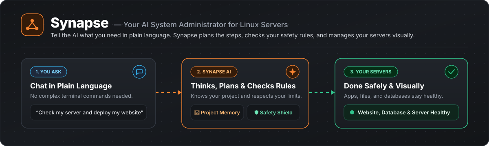
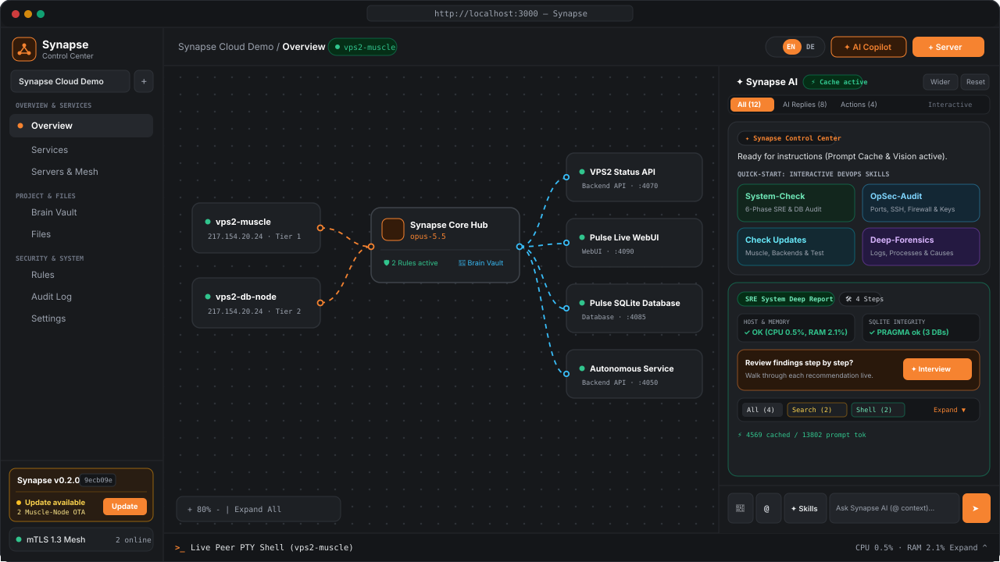
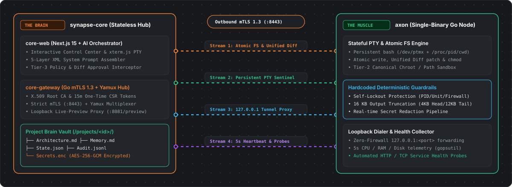
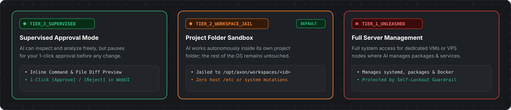

<div align="center">



<br />

[-f68330?style=for-the-badge&labelColor=181a1d)](./README.md)
[](./README.de.md)

[](https://github.com/SolidStateNetwork/Synapse/actions/workflows/ci.yml)
[](https://github.com/SolidStateNetwork/Synapse/releases)
[](https://m8ven.ai/mcp/solidstatenetwork/synapse)
[](#)
[](#)
[-f68330?labelColor=181a1d)](./LICENSE)

### **Synapse — Your AI-Managed Linux Server & DevOps Control Center**
Manage, monitor, and repair your Linux servers together with an AI — through a clean visual control center and built-in **Model Context Protocol (`MCP`) Server** instead of hours of manual troubleshooting in the terminal.

[What is Synapse?](#-what-is-synapse) · [The 6 Core Pillars](#-the-6-core-pillars) · [How It Works (Core & Muscle)](#-how-is-synapse-built-core--muscle) · [Security & Control](#️-security--control) · [Quick Start](#-quick-start-in-2-steps) · [Architecture Lexicon](#-repository-navigation--architecture-lexicon)

</div>

---

## 💡 What is Synapse?

Anyone running one or more Linux servers knows the routine: connecting via SSH, digging through endless log files for errors, editing configuration files by hand, applying updates, and manually checking whether every service is still healthy afterward.

**Synapse is an AI-Managed Infrastructure Control Center (`v2.3.0`) designed to take that routine work off your shoulders.**

Instead of typing shell commands yourself, you work inside a visual dashboard (available in **English** and **German**) alongside an integrated AI system administrator — or connect external AI clients like **Claude Desktop, Cursor, or Windsurf** via the built-in **MCP Server (`/api/mcp`)**. The AI is connected directly to your servers over an outbound `mTLS 1.3` tunnel: it can inspect system health, deploy services, audit security, create automatic **Pre-Flight Time-Machine Checkpoints**, and self-heal crashes — while you stay in full visual control and keep the final say on every change.

---

## 🎯 The 6 Core Pillars

### 1. Interactive AI Chat, 1-Click DevOps Skills & Interview Mode
Beyond normal chat (where you can give instructions in plain language, reference servers with `@`, or drag and drop screenshots), Synapse includes ready-to-use **DevOps Skills** right inside the AI Copilot panel:
- **`CheckSystem`:** Runs a deep health audit across your servers (CPU/RAM/disk, running services, SQLite databases, logs, and configuration).
- **`CheckOpsec`:** Audits your servers for security risks (open ports, SSH configuration, firewall rules, file permissions, and HTTP headers).
- **`CheckUpdates`:** Checks all connected servers, services, and system packages for available updates, asks for your approval, and automatically runs an end-to-end functional test afterward.
- **`DeepForensics` & `SkillSearch`:** Finds hidden root causes in logs or immediately locates any file, port, database table, or feature across your infrastructure.

> **Interactive Interview Mode:** After a skill finishes its report, the AI never modifies your system unprompted. Click **"Start Interview"** and the AI walks you through each finding one by one, asking: *"Fix this item now or skip?"*

### 2. Visual Topology Canvas, Service Workbench & Built-In Browser App Tester
On the main **Overview** screen, all connected servers, the AI hub, and your running applications appear as interactive cards that you can expand and arrange freely:

<div align="center">
  
</div>

- **Test Services Without Opening Firewall Ports:** When the AI deploys a web app, an API, or a SQLite database on your server, you can open and test it directly inside your browser under **Services** (`GET`/`POST`/`PUT`/`DELETE`/`SQL` Workbench) — without exposing public ports on your server's firewall.
- **GitOps Stack Deployer, Live-Log Inspector & Cron-Due Runner:** Clone and deploy Git repositories (`docker compose up -d --build`) with automatic `Secrets.enc` -> `0600 .env` injection, webhook redeploy & 1-click teardown, inspect live `docker`/`systemd`/`workspace` service logs over mTLS, and run scheduled Cron-Runbooks with automatic `CRITICAL` forensic alerts.
- **Live-Code Hot-Reload & SQLite Data Studio:** Edit running microservice code live in the browser with automatic Python syntax validation and rollback protection, or inspect and query SQLite tables directly over the mTLS tunnel.

### 3. Automatic Pre-Flight Time-Machine Checkpoints & Autonomous Self-Healing
- **Pre-Flight Time-Machine Checkpoints (`chk-...`):** Before every mutating operation (Blueprint deploy/undeploy, GitOps rollout/teardown, Custom-Service deploy, Live-Code Hot-Reload, Firewall policy change, or OTA System Update), Synapse automatically captures a restorable **Time-Machine Checkpoint** and displays the `checkpoint_id` badge right in the UI.
- **Autonomous Self-Healing & Chaos-Resilience:** Continuously monitors service health and latency, automatically restarts crashed containers or daemons, measures **MTTR (Mean Time To Recovery)**, and supports 1-click Chaos Engineering crash simulations.
- **Encrypted Offsite Backups (`AES-256-GCM`):** Archive and restore full project & workspace snapshots directly inside the Core Vault.

### 4. Built-In Model Context Protocol (`MCP`) Server (`/api/mcp` — 33 Tools)
Connect **Claude Desktop, Cursor, Windsurf, or any MCP-compatible AI agent** directly to your Synapse Control Center via Streamable HTTP JSON-RPC 2.0 (`/api/mcp`):
- **33 Full-Stack Tools:** 100% parity across PTY execution, filesystem operations, GitOps stacks, Time-Machine checkpoints, Offsite backups, Self-Healing, Service-Mesh probes, 1-Click Blueprints, Custom Domain/TLS bindings, Synapse Shield Firewall, AI Rule Cartridges, Cluster Node enrollment, Scheduled AI Playbooks, Supervised Approvals, Service Action Workbench, and Platform Self-Tests.
- **Scoped SHA-256 API Keys (`syn_mcp_...`):** Issue granular `read`, `execute`, or `admin` MCP tokens and revoke them at any time with 1 click.

### 5. Effortless 1-Click OTA Updates (Bare-Metal & Container-Native)
Just like NetBird, Synapse displays your current version (`v2.3.0`) and commit status right in the **bottom-left corner of the sidebar**:
- **Instant Update Notification & Pre-Flight Rollout:** Whenever a new update is available for **Core** or your connected **Muscle** nodes, a 1-click **`Update`** button creates a Pre-Flight Time-Machine Checkpoint and updates both bare-metal systemd services and container deployments seamlessly.

### 6. Project Memory (`Brain Vault`) & Modular AI Rule Cartridges (`Rules`)
- **Persistent Brain Vault:** Automatically maintains `Architecture.md` (with live Mermaid topology graphs) and `Memory.md` (engineering journal) per project workspace.
- **1-Click Rule Cartridges:** Toggle built-in or custom policy guardrails (*Docker-First*, *Zero-Trust Networking*, *Native Systemd*) to `ACTIVE` so the AI strictly follows your architectural standards.

---

## 🧠 How is Synapse Built? (Core & Muscle)

Synapse is split into two clearly separated components:

1. **The Core ("The Brain" — `synapse-core`):**
   Your central web dashboard, AI orchestrator, and encrypted secret vault. Untrusted code or shell commands are never executed on the Core itself.
2. **The Muscle ("The Hands" — `axon`):**
   A lightweight, dependency-free single Go binary that you install on your Linux servers. It connects outbound to your Core over an encrypted `mTLS 1.3` tunnel and executes the file operations, health checks, and shell commands required for your projects.

<div align="center">
  
</div>

---

## 🛡️ Security & Control

You decide how much autonomy the AI gets on each connected server:

<div align="center">
  
</div>

1. 🟢 **Supervised Mode (`TIER_3_SUPERVISED`):** The AI can read and analyze freely, but pauses and asks for your approval in the WebUI before every file change or shell command.
2. 🟡 **Project Folder Sandbox (`TIER_2_WORKSPACE_JAIL` — Default):** The AI works autonomously inside its own project folder (`/opt/axon/workspaces/...`), while access to the rest of the operating system is blocked.
3. 🔴 **Full Server Management (`TIER_1_UNLEASHED`):** For dedicated VMs or VPS nodes where you want the AI to install system packages, manage systemd services, and administer the entire machine.

Built-in safety mechanisms protect your infrastructure at all times:
- **Encrypted Secrets:** API keys and passwords are encrypted at rest (`AES-256-GCM` in `Secrets.enc`) and automatically redacted from chat outputs and logs.
- **1-Click Rollback:** Before modifying any file, Synapse creates an automatic snapshot so you can revert changes with a single click right from the chat.
- **Complete Audit Trail (`Audit Log`):** Every AI and operator action is logged chronologically.

---

## 🚀 Quick Start in 2 Steps

### Step 1 — Start the Control Center (`Core`) with Docker
Run this command on the machine that will host your WebUI:

```bash
curl -fsSL https://raw.githubusercontent.com/SolidStateNetwork/Synapse/main/scripts/deploy-core.sh | bash
```

Once started, open the **Synapse Control Center** in your browser at `http://<YOUR_CORE_IP>:3000`.

### Step 2 — Connect a Linux Server (`Muscle`)
Click **`+ Server`** in the top-right corner of the WebUI, click **"Generate Setup Key"**, and run the generated one-line command on your Linux server:

```bash
curl -fsSL http://<YOUR_CORE_IP>:8081/install.sh | sudo sh -s -- <ONE_TIME_TOKEN> TIER_2_WORKSPACE_JAIL
```

Your server connects automatically in the background (without opening any inbound firewall ports) and appears live on your topology canvas.

---

## 🛠️ Local 2-Container Lab & Developer Build

```bash
# Option A: Launch the complete 2-Container Local Lab (synapse-core + synapse-muscle)
bash containers/manage.sh restart
bash containers/manage.sh status

# Option B: Run full test & coverage gates (>= 85% Go across 11 packages, >= 90% TS line coverage)
go test -v -race -cover ./proto/... ./agents/axon/... ./apps/core-gateway/...
npm --prefix apps/core-web ci
npx --prefix apps/core-web tsc -p apps/core-web/tsconfig.json --noEmit
npm --prefix apps/core-web test -- --experimental-test-coverage
npm --prefix apps/core-web run build
```

---

## 📂 Repository Navigation & Architecture Lexicon

- **Architecture & Engineering Specifications:** [`architecture/`](./architecture/)
  - [`00-product-vision.md`](./architecture/00-product-vision.md) – Core ("The Brain") & Muscle ("The Hands") separation & 3 Autonomy Tiers
  - [`01-tech-stack-and-monorepo.md`](./architecture/01-tech-stack-and-monorepo.md) – Go 1.23 workspace, Next.js 15 Studio & `< 500` Go / `< 600` TS modularization gates
  - [`02-mtls-tunnel-and-axon-agent.md`](./architecture/02-mtls-tunnel-and-axon-agent.md) – ECDSA P-256 PKI, Yamux multiplexing, Ephemeral PTY GC & Self-Lockout Guard
  - [`03-ai-orchestrator-and-mcp-server.md`](./architecture/03-ai-orchestrator-and-mcp-server.md) – 33 AI/MCP tools, Prompt Caching & Streamable HTTP JSON-RPC 2.0 MCP Server
  - [`04-resilience-security-and-ota.md`](./architecture/04-resilience-security-and-ota.md) – `AES-256-GCM` Secret Vault, Pre-Flight Time-Machine Checkpoints, Self-Healing & OTA
- **Project Memory & Roadmap:** [`memory/`](./memory/)
  - [`PROJECT_STATE.md`](./memory/PROJECT_STATE.md) – Live subsystem status matrix (`v2.3.0`)
  - [`MILESTONES.md`](./memory/MILESTONES.md) – End-to-end engineering roadmap (`Phase 1`–`Phase 6`)
  - [`BLACKBOX.md`](./memory/BLACKBOX.md) – Chronological engineering log & Architecture Decision Records (`ADR-001`–`ADR-006`)
- **Standard Operating Procedures:** [`playbooks/`](./playbooks/)
  - [`01-feature-and-milestone-sop.md`](./playbooks/01-feature-and-milestone-sop.md) – Feature development, modularization & test gate SOP
  - [`02-container-lab-and-release-sop.md`](./playbooks/02-container-lab-and-release-sop.md) – Local 2-Container Lab & GitHub release SOP
- **Governance, Security & Changelog:** [`AGENTS.md`](./AGENTS.md) · [`CONTRIBUTING.md`](./CONTRIBUTING.md) · [`SECURITY.md`](./SECURITY.md) · [`CHANGELOG.md`](./CHANGELOG.md)

---

## 📄 License

Released under the [Synapse Source-Available Non-Commercial License](./LICENSE) (`Copyright (c) 2026 SolidStateNetwork — All Rights Reserved`). Free for personal use, testing, and non-commercial self-hosting; commercial sale, resale, or managed SaaS hosting is strictly prohibited without a written commercial license from SolidStateNetwork. See [SECURITY.md](./SECURITY.md) for security policy and reporting guidelines.
