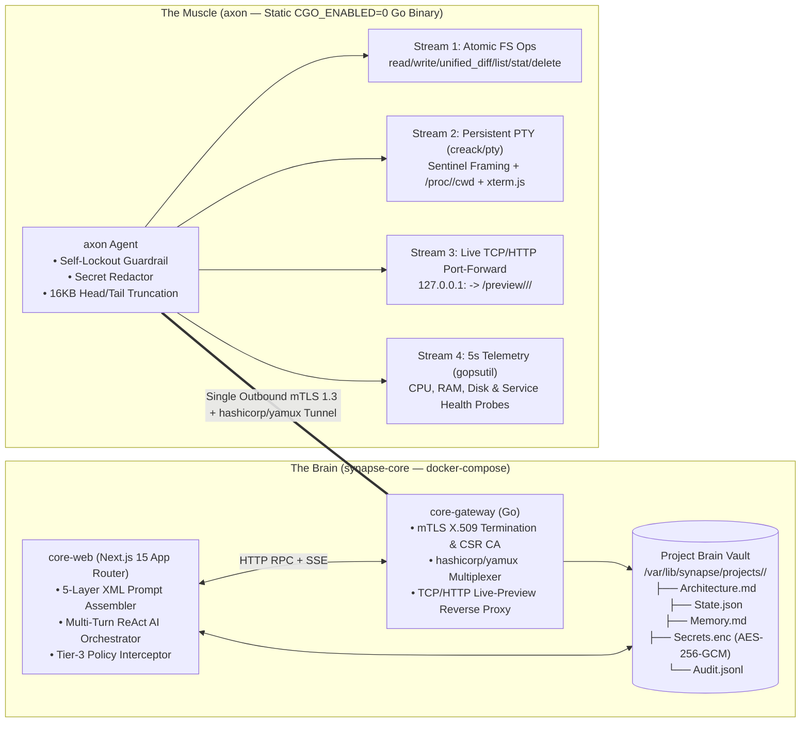

<div align="center">

# Synapse

### The "Brain & Muscle" Self-Hosted AI DevOps & Autonomous Engineering Platform

[](https://github.com/SolidStateNetwork/Synapse/actions/workflows/ci.yml)
[](https://github.com/SolidStateNetwork/Synapse/releases)
[](https://go.dev/)
[](https://nextjs.org/)
[](./LICENSE)

**Stateless Cognitive Control Plane (`synapse-core`)** · **Stateful Single-Binary Remote Nodes (`axon`)** · **mTLS 1.3 + Yamux Reverse Tunnel**

[Releases & Binaries](https://github.com/SolidStateNetwork/Synapse/releases) · [Changelog](./CHANGELOG.md) · [Security Policy](./SECURITY.md) · [Contributing](./CONTRIBUTING.md)

</div>

---

## 1. Architectural Law & System Topology

**Synapse** strictly separates cognitive orchestration (**The Brain**) from stateful code execution (**The Muscle**):

> **ARCHITECTURAL LAW:** The Synapse Core Control Plane **NEVER** compiles or executes user application code. It holds zero developer runtimes. All shell execution, filesystem mutations, and service hosting occur exclusively on enrolled **Axon Muscle Nodes** over a single outbound **mTLS 1.3 + `hashicorp/yamux` multiplexed reverse tunnel**. Without at least one assigned Connector Node, a project is deterministically locked in **Planning-Only Mode**.



---

## 2. Prebuilt Release Binaries & Quickstart

### Download Prebuilt `axon` Binaries
Static, zero-dependency (`CGO_ENABLED=0`) binaries are built automatically for every release on [GitHub Releases](https://github.com/SolidStateNetwork/Synapse/releases):

| Binary | Architecture | OS | Download |
| :--- | :--- | :--- | :--- |
| `axon-linux-amd64` | `x86_64` | Linux | [Latest Release](https://github.com/SolidStateNetwork/Synapse/releases/latest/download/axon-linux-amd64) |
| `axon-linux-arm64` | `aarch64` | Linux | [Latest Release](https://github.com/SolidStateNetwork/Synapse/releases/latest/download/axon-linux-arm64) |
| `axon-darwin-amd64` | `x86_64` | macOS | [Latest Release](https://github.com/SolidStateNetwork/Synapse/releases/latest/download/axon-darwin-amd64) |
| `axon-darwin-arm64` | `Apple Silicon` | macOS | [Latest Release](https://github.com/SolidStateNetwork/Synapse/releases/latest/download/axon-darwin-arm64) |
| `core-gateway-linux-amd64` | `x86_64` | Linux | [Latest Release](https://github.com/SolidStateNetwork/Synapse/releases/latest/download/core-gateway-linux-amd64) |

### 1. Start the Brain (`synapse-core`)
```bash
git clone https://github.com/SolidStateNetwork/Synapse.git
cd Synapse
docker compose up --build -d
# Studio WebUI: http://localhost:3000
# Core Gateway: http://localhost:8081 (HTTP Control & Live-Preview) / :8443 (mTLS Yamux)
```

### 2. Enroll a Remote Muscle Node (`axon`)
Generate a one-time join token in the Studio WebUI (or via `POST /api/gateway/token`), then run on any target server:
```bash
curl -sSL http://<core-host>:8081/install.sh | sudo bash -s -- http://<core-host>:8081 <ONE_TIME_TOKEN> <NODE_ID> TIER_2_WORKSPACE_JAIL
```
Or manually with the static binary:
```bash
curl -fL https://github.com/SolidStateNetwork/Synapse/releases/latest/download/axon-linux-amd64 -o /usr/local/bin/axon
chmod +x /usr/local/bin/axon
axon join --core http://<core-host>:8081 --node-id prod-node-01 --tier TIER_2_WORKSPACE_JAIL --run <ONE_TIME_TOKEN>
```

---

## 3. Core Subsystems

### 3.1 The Brain (`synapse-core`)
1. **`apps/core-gateway` (Go):**
   - Initializes a self-contained X.509 Root CA and issues 15-minute single-use CSR join tokens (`/api/v1/tokens`).
   - Signs ECDSA P-256 Certificate Signing Requests submitted via `axon join <token>` (`/api/v1/bootstrap/csr`).
   - Terminates strict mutual TLS (`tls.RequireAndVerifyClientCert`) on port `8443` and multiplexes 4 stream types via `hashicorp/yamux`.
   - Exposes the authenticated **Live-Preview Reverse Proxy** at `/preview/<project_id>/<node_id>/<port>`, tunneling traffic directly to `127.0.0.1:<port>` on the remote node without opening public firewall ports.
2. **`apps/core-web` (Next.js 15 App Router + TypeScript):**
   - Manages the on-disk **Project Brain Vault** (`/var/lib/synapse/projects/<project_id>/`):
     - `Architecture.md`: Living Mermaid system topology and remote file layout.
     - `State.json`: Assigned nodes, 5-second hardware telemetry, active PTY sessions, and registered services.
     - `Memory.md`: Chronological engineering journal and lessons learned.
     - `Secrets.enc`: AES-256-GCM encrypted key-value store (write-only to the LLM).
     - `Audit.jsonl`: Immutable append-only log of all AI tool calls, policy intercepts, and user approvals.
   - Implements the **5-Layer XML Master-System-Prompt Assembler** and **Multi-Turn ReAct Orchestrator** supporting OpenAI, Anthropic, Ollama, Custom API Base URLs, and deterministic execution.

### 3.2 The Muscle (`agents/axon`)
- **Persistent PTY Sentinel Framing (`internal/pty`):**
  Every `node_pty_exec` command runs inside a persistent `creack/pty` bash session with a deterministic boundary sentinel (`__SYNAPSE_EOF_<cmd_id>:<exit_code>__`), preserving environment variables, background processes, and working directory (`/proc/<shell_pid>/cwd`) across tool turns while mirroring live output to `xterm.js`.
- **Atomic Filesystem Engine (`internal/fs`):**
  Supports `read_file`, atomic `write_file` (temp-file + `os.Rename`), `apply_unified_diff`, `list_dir`, `stat`, `delete`, and octal `file_mode` permissions (`0644`, `0755`).

---

## 4. Deterministic Security, Autonomy Tiers & Rule Cartridges

### Hardcoded Node Guardrails (`agents/axon/internal/guard`)
1. **Self-Lockout Prevention (`ERR_SELF_PROTECTION_VIOLATION`):** Detects `axon`'s own PID, `axon.service`, and the outbound Core Gateway IP/port. Deterministically blocks any command (`kill`, `pkill`, `systemctl stop/disable/mask axon`, `ufw`/`iptables`/`nft` drop rules) that would terminate the agent or sever the mTLS tunnel.
2. **Context-Window Protection (16 KB Head/Tail Truncation):** Strips ANSI escape sequences and enforces a **16 KB output cap** per command (first **4 KB head** + last **12 KB tail**), persisting the full log to `/tmp/axon-logs/<cmd_id>.log`.
3. **Secret Redaction:** Secrets from `Secrets.enc` injected into PTY sessions are deterministically scrubbed as `[REDACTED_SECRET:KEY]` before leaving the node.

### Node Autonomy Tiers
| Tier | Execution Rights | Enforcement Mechanism |
| :--- | :--- | :--- |
| `TIER_1_UNLEASHED` | Full root/sudo autonomy | Autonomous host & service provisioning |
| `TIER_2_WORKSPACE_JAIL` | Unprivileged workspace sandbox | Canonical path jail inside `/opt/axon/workspaces/<project_id>` |
| `TIER_3_SUPERVISED` | Human-in-the-Loop approval | Write/exec tools pause in the WebUI with live Command & Diff Preview |

### Official DevOps Rule Cartridges (`/cartridges/*.md`)
- [`docker-first.md`](./cartridges/docker-first.md): Enforces containerized workloads with healthchecks and `127.0.0.1` port bindings.
- [`native-systemd.md`](./cartridges/native-systemd.md): Enforces hardened `systemd` unit files (`ProtectSystem=strict`, `NoNewPrivileges=true`).
- [`zero-trust-networking.md`](./cartridges/zero-trust-networking.md): Enforces `127.0.0.1` service bindings and firewall safety rules.
- [`auto-ssl-caddy.md`](./cartridges/auto-ssl-caddy.md): Configures automated Caddy TLS reverse-proxy blocks with security headers.

---

## 5. Build & Test from Source

```bash
# 1. Test and build Go modules (proto, axon, core-gateway)
CGO_ENABLED=0 go test -v ./proto/... ./agents/axon/... ./apps/core-gateway/...
CGO_ENABLED=0 go build ./proto/... ./agents/axon/... ./apps/core-gateway/...

# 2. Build Next.js 15 Core WebUI
npm --prefix apps/core-web ci
npm --prefix apps/core-web run build
```

## License

Released under the [MIT License](./LICENSE).
