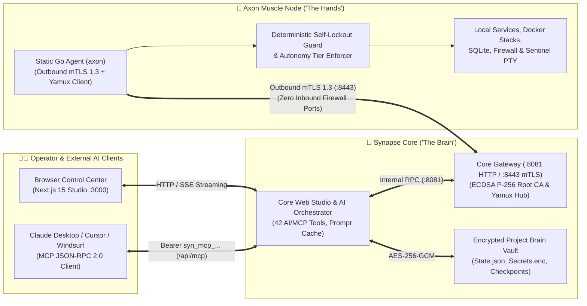

# 🎯 00 — Product Vision & Architectural Principles (Synapse)

> **Synapse (`SolidStateNetwork/Synapse`)** is a self-hosted, AI-managed Linux server and DevOps control center (**AI-Managed Infrastructure Control Center**) that unifies visual topology management, autonomous self-healing, zero-trust security, and the **Model Context Protocol (`MCP`)** in a single standalone platform.

---

## 1. The Core Problem of Traditional Server Administration

Operators running Linux servers, microservices, and databases traditionally face two extremes:
1. **Manual SSH & Terminal Administration:** Every diagnosis, deployment, firewall update, and log audit requires manual SSH sessions, ad-hoc shell commands, and manual dependency checks.
2. **Unchecked AI Scripts Without a Safety Net:** Granting a language model raw root access without a deterministic policy gate risks self-lockout (firewall/SSH lockout), silent configuration drift without rollback, or leaked API credentials in chat contexts.

**Synapse resolves this trade-off through strict separation into "The Brain" (`Core`) and "The Hands" (`Muscle`), combined with deterministic security guardrails.**

---

## 2. Two-Component Architecture: Core ("The Brain") & Muscle ("The Hands")

### 🧠 1. Synapse Core ("The Brain")
- **Centralized Control & Visualization:** Hosts the interactive web cockpit (Topology Canvas, Live-Preview Reverse Proxy, Code & SQLite Studio, Firewall Matrix, Time-Machine Checkpoints) as well as the built-in **MCP Server (`/api/mcp`)**.
- **Zero Untrusted Execution on Core:** Untrusted user scripts are never executed on the Core itself. The Core manages the encrypted project memory (`Brain Vault`) and validates every AI action inside the **Policy Interceptor**.

### 💪 2. Axon Muscle ("The Hands")
- **Dependency-Free Single Binary (`axon`):** A statically compiled Go agent for Linux (`amd64` & `arm64`).
- **Zero-Inbound-Port Architecture:** The Muscle server requires **zero open inbound firewall ports**. `axon` dials outbound over a mutually authenticated **mTLS 1.3 + Yamux** tunnel to the Core Gateway (`:8443`).

---

## 3. The 3 Autonomy Tiers (`Autonomy Tiers`)

Every connected Muscle node operates under an explicitly enforced autonomy tier:

| Autonomy Tier | Target Environment / Use Case | Technical Enforcement |
| :--- | :--- | :--- |
| **`TIER_3_SUPERVISED`** | Production servers requiring strict human approval | Read and diagnostic tools run immediately; every mutating filesystem, PTY, or firewall operation pauses on the Core and requires a **1-Click Approve** in the WebUI or via MCP. |
| **`TIER_2_WORKSPACE_JAIL`** *(Default)* | Shared development and application servers | The AI operates autonomously, but canonical path validation (`filepath.Clean` + recursive `filepath.EvalSymlinks`) strictly confines all file operations to `/opt/axon/workspaces/<project_id>`. |
| **`TIER_1_UNLEASHED`** | Dedicated VMs, containers, or cloud VPS instances under full AI management | Full system autonomy (Systemd, Docker, Firewall, package management) protected by the **Deterministic Self-Lockout Guard** and **Pre-Flight Time-Machine Checkpoints**. |

---

## 4. Core Engineering Principles

1. **100% Full-Stack AI & MCP Parity:** Every action an operator can trigger in the WebUI must also be exposed as a typed tool for the internal AI Orchestrator and external MCP clients (`SYNAPSE_TOOL_SCHEMAS`).
2. **Pre-Flight Time-Machine Checkpoints Before Every Mutation:** Every state-changing operation (Blueprint rollout, GitOps deploy/teardown, Custom-Service deploy, Hot-Reload, Firewall change, OTA update) automatically records a restorable checkpoint (`chk-...`) beforehand.
3. **Zero-Leak Secret Management:** Secrets are stored exclusively with **AES-256-GCM** (`Secrets.enc`) on disk, never sent in plaintext to the LLM, and automatically scrubbed from all terminal and audit outputs (`[REDACTED_SECRET:KEY]`).
